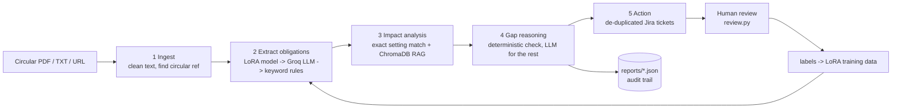

# RegDrift


**When a regulator publishes a new circular, which of your automated workflows just became non-compliant?**
RegDrift reads RBI circulars, extracts the checkable rules, finds the RPA bots (UiPath / Blue Prism style) they affect,
compares each rule with the bot's real settings, and files de-duplicated Jira tickets with severity and the exact clause.

Banks run hundreds of bots (KYC, loan processing, reconciliation). Nobody tells bot owners when a circular changes a
limit or a deadline, so gaps are found in audits, months later. RegDrift turns that into a ticket the same day.

## What it produced on two real RBI circulars

| Circular | Finding | Severity |
|---|---|---|
| RBI/2026-27/291 (FX derivatives) | `FX-Derivative-Booking-Bot` still allows rebooking of cancelled contracts (clause a) | High |
| | `Hedge-Limit-Checker-Bot` threshold is 100, circular now says 5 (clause c) | High |
| | `Hedge-Documentation-Bot` does not capture the "not hedged elsewhere" undertaking (clause d) | High |
| | `Hedge-Documentation-Bot` keeps records 5 years, rule needs at least 2 (clause 3) | Compliant, no ticket |
| RBI/2026-27/257 (KYC amendment) | `KYC-Document-Verification-Bot` accepts certified copies for NRI/PIO but not the newly permitted FPI | Low (`optional_gap`) |

The second row shows the distinction that matters: the KYC circular says banks **may** do something. A bot that does not
is not breaking the law, so it gets a *Low optional_gap* ticket, not a *High violation*.
(The bots are simulated and their settings were written to mirror the circulars. See *Limitations*.)

## How it works



The five steps are a LangGraph graph (with a plain sequential fallback).

**Design decisions worth knowing**
- **Deterministic before generative.** If a bot exposes the rule's setting (`str_filing_days = 7`), the verdict comes from
  arithmetic, not an LLM. The LLM only judges bots with no matching setting, and may answer *not applicable*.
- **Mandatory vs permissive.** `shall/must` rules produce violations; `may` rules produce Low `optional_gap` tickets.
- **LLM output is untrusted.** Every extracted obligation is schema-validated (operator allow-list, value types);
  malformed items are dropped and counted. The circular text is fenced as data in the prompt.
- **Safe to re-run.** Tickets are matched on (bot, clause, circular) against Jira, so repeat runs create nothing new.
- **Auditable.** Each run writes `reports/<circular>.report.json`: input SHA-256, model used, every obligation, every
  finding (including compliant ones) and ticket keys.
- **Resilient.** Rate limits and server errors are retried with backoff; unavailable models are skipped; the pipeline
  degrades to offline keyword rules rather than failing.

## Run it (no local install needed)

**GitHub Actions:** Actions > *RegDrift* > *Run workflow*. Pick a circular (or the folder `circulars/`), optionally *dry run* /
*fail on high* (a compliance gate that fails the run on any violation). Reports are uploaded as an artifact.
**Colab:** open `RegDrift_Colab.ipynb`.
**Locally:**
```bash
pip install -r requirements.txt
python regdrift.py circulars/rbi_fx_derivatives_2026-10-10.pdf --dry-run
python -m unittest discover -s tests
```
Add free keys to switch on the LLM and Jira (see `.env.example`). With no keys everything still runs offline.

| Command | Purpose |
|---|---|
| `python regdrift.py <pdf/txt/url/folder> [--dry-run] [--fail-on-high]` | analyse circulars |
| `python import_bot.py Config.xlsx --name KYC-Refresh-Bot --description "..."` | add/update a bot from a UiPath `Config.xlsx` (or a Name,Value CSV for other tools) |
| `python review.py` | approve/reject tickets; labels feed training |
| `python distill.py` / `review_candidates.py` / `build_lora_data.py` / `train_lora.py` / `evaluate.py` | LoRA pipeline (below) |

## The LoRA extractor (optional)

A small model (Qwen2.5-0.5B-Instruct + LoRA) that turns one clause into structured obligations, so extraction can run
locally and cheaply instead of calling an LLM.

1. `distill.py`: Groq proposes labels for every clause in `circulars/` (resumable, rate-limit aware).
2. `review_candidates.py`: each proposal is accepted, fixed or rejected. Only reviewed rows become training data. (In the
   reported run the review was done by Claude, an LLM, not by a human compliance expert; see Results.)
3. `build_lora_data.py`: builds train/test, **holding out whole circulars** so the test measures generalisation,
   with leakage and duplicate guards. Fewer than 4 circulars means no test set (it will not fake one).
4. `train_lora.py`: LoRA fine-tune on a free Colab T4 (loss on the JSON completion only).
5. `evaluate.py`: keyword baseline vs Groq zero-shot vs the LoRA model on the held-out circulars
   (detection F1, exact match, content match) -> `docs/eval_results.md`.

Run it all from `RegDrift_LoRA_Train.ipynb`.

### Results

First proof-of-concept run: 11 real RBI circulars, 33 clauses, 10 of which carry a checkable rule. Held-out test:
3 whole circulars never seen in training (8 clauses, **only 1 contains a rule**).

| Extractor | Detection F1 | Precision | Recall | Exact match | Content match |
|---|---|---|---|---|---|
| Keyword baseline | 0.00 | 0.00 | 0.00 | 0.88 | 0.88 |
| Groq LLM (zero-shot) | 1.00 | 1.00 | 1.00 | 0.88 | 0.88 |
| LoRA-tuned Qwen2.5-0.5B | 1.00 | 1.00 | 1.00 | 1.00 | 1.00 |

**How to read this honestly:**
- The test set has 8 clauses and a single positive, so every number is one clause away from changing. This shows the
  train/evaluate pipeline works end to end. It does **not** show that the small model beats Groq or generalises.
- The held-out KYC circular is worded almost exactly like six KYC circulars in the training set (same text for different
  bank types), so it is an easy test.
- Labels were proposed by Groq and reviewed by Claude (an LLM), not by a human compliance expert. Groq's score is also
  slightly depressed because the reviewed labels use short names (`NRI`) where Groq writes long ones.
- Next step for a meaningful number: circulars on other topics (loans, reporting deadlines, limits), at least 30 rule-bearing clauses
  in the test set.

## Web app

A small web interface sits on top of the same pipeline: add a circular (PDF, text, or one of the bundled samples), see
which bots are out of line, approve or dismiss each finding, then download a CSV or create the Jira tickets.
Each finding shows a *drift line*: where the rule's limit is and where the bot's setting actually sits.

Run it anywhere (Codespaces shows an "Open in Browser" prompt for the port):
```
pip install -r requirements.txt -r requirements-web.txt
export GROQ_API_KEY=...            # optional; without it the keyword rules are used
uvicorn webapp.app:app --port 8000
```

Safe to host publicly:
- Checks never write to Jira. Creating tickets is off unless the host sets `APP_ACCESS_CODE` **and** the `JIRA_*` variables,
  and the person must enter the code first.
- Only an uploaded file, pasted text, or a listed sample is read. The app never fetches URLs.
- Limits protect the free Groq quota: 10 checks per hour per visitor (`RATE_PER_HOUR`), 200 a day (`MAX_PER_DAY`),
  2 at once, 6 MB per file.

Deploy for free: on render.com choose **New > Web Service**, connect this repo, runtime **Docker**, free instance, and
add `GROQ_API_KEY` (plus, only if you want ticketing, `JIRA_URL`, `JIRA_EMAIL`, `JIRA_TOKEN`, `JIRA_PROJECT`,
`APP_ACCESS_CODE`). Free instances sleep when idle, so the first visit can take about a minute.

The samples the page offers are listed in `circulars/samples.json`.

## Dashboard and Docker
Every command-line run also writes `reports/dashboard.html`, a self-contained page with severity counts and every
finding with its Jira key. Rebuild it from existing reports with `python dashboard.py`.

```
docker build -t regdrift .
docker run --rm -p 7860:7860 -e GROQ_API_KEY regdrift                      # web app
docker run --rm -e GROQ_API_KEY regdrift python regdrift.py circulars --dry-run   # command line
```

## Project layout
```
regdrift.py            pipeline + CLI (LangGraph graph, validation, retries, Jira, reports)
dashboard.py           reports/*.json -> reports/dashboard.html (written after every command-line run)
webapp/                web app: app.py (Starlette API) + static/ (hand-written HTML, CSS, JS)
Dockerfile             container image (secrets via environment variables only)
import_bot.py          UiPath Config.xlsx / CSV -> bots.json
review.py              human review of tickets
distill.py  review_candidates.py  build_lora_data.py  train_lora.py  evaluate.py   LoRA pipeline
bots.json              demo bots (simulated)        circulars/   real circular PDFs
data/seed_examples.jsonl   hand-written training seeds     tests/   unit tests (run in CI)
RegDrift_Colab.ipynb  RegDrift_LoRA_Train.ipynb  .github/workflows/run.yml  .env.example
```

## Limitations (read before relying on it)
- **The bots are simulated.** Their settings were written by hand to mirror the test circulars, so the headline results
  show the pipeline works, not that it generalises to your bank's automations. Test it on circulars you did not design for.
- **Bot ingestion.** `import_bot.py` reads the UiPath REFramework `Config.xlsx` layout (Name/Value/Description sheets) and
  generic Name,Value CSVs; it was tested on generated files, not a real production export. It does not parse Blue Prism
  release files; export the bot's environment variables to CSV instead.
- **Value matching is heuristic.** List values are compared ignoring case, plurals and acronyms (so "Foreign Portfolio
  Investors" matches `FPI`), but unrelated synonyms (e.g. FII vs FPI) are not matched and would show as a gap.
- **Extraction can be wrong.** LLM and LoRA output is validated for shape, not truth. Tickets are for a human to confirm.
- **Rules need a matching setting.** If a rule maps to a setting that some bot owns, only bots with that setting are
  judged. If no bot owns the setting, related bots are flagged *at risk* (never High) for manual review.
- **Scanned PDFs** (images) need OCR first; text-based PDFs only.
- **Free tiers:** Groq rate limits apply (handled with backoff); Colab sessions disconnect (progress is saved to Drive).
- **LoRA quality scales with reviewed data.** A few dozen examples gives a proof of concept, not a production model.
- Not legal or compliance advice. Always confirm circulars at rbi.org.in.

## Security
Secrets come from environment variables / repository secrets only and are never logged or committed
(`.env` is git-ignored). The workflow passes inputs through environment variables, not shell interpolation.

## License
MIT. See `LICENSE`.
