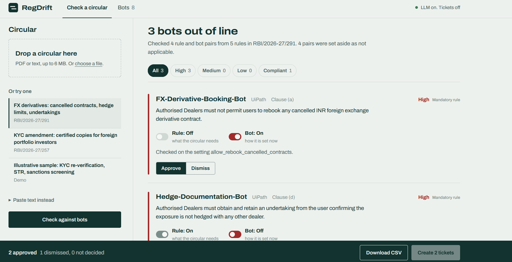
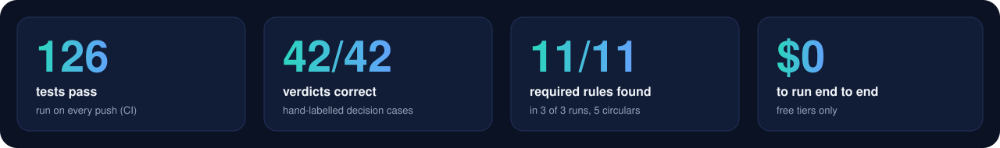
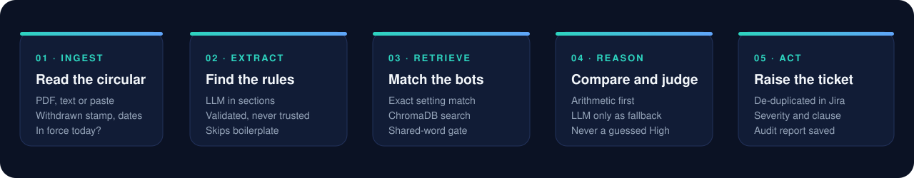
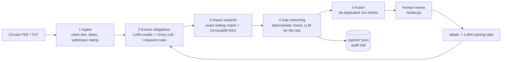
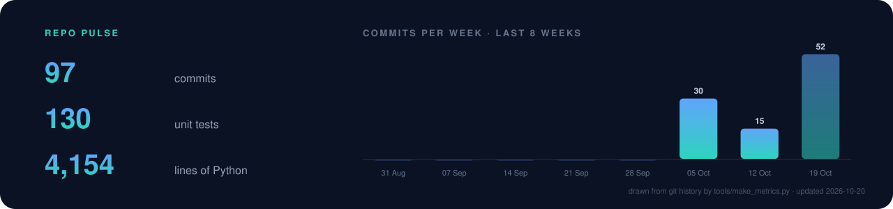

<div align="center">



<br>

[](https://github.com/Ajitesh1234/RegDrift/actions/workflows/run.yml)
[](https://regdrift.onrender.com)
[](https://github.com/Ajitesh1234/RegDrift/commits/main)
[](requirements.txt)
[](LICENSE)
[](#-limitations-read-before-relying-on-it)
[](https://hits.sh/github.com/Ajitesh1234/RegDrift/)

**[Live demo](https://regdrift.onrender.com)** ·
**[How it works](#-how-it-works)** ·
**[Results](#-measured-results)** ·
**[Time awareness](#-is-the-circular-still-in-force)** ·
**[Run it](#-run-it)** ·
**[Limitations](#-limitations-read-before-relying-on-it)**

<sub>The live demo runs on a free instance that sleeps when idle, so the first visit can take about a minute.</sub>

</div>

<br>

> **When a regulator publishes a new circular, which of your automated workflows just became non-compliant?**

Banks run hundreds of RPA bots (UiPath, Blue Prism) for KYC, loan processing and reconciliation. Nobody tells the bot
owners when a circular changes a limit or a deadline, so the gap is found in an audit, months later.

**RegDrift reads the circular, extracts the checkable rules, finds the bots they affect, compares each rule with the bot's
real settings, and files a de-duplicated Jira ticket with the severity and the exact clause, the same day.**

<table>
<tr>
<td width="50%" valign="top">

**What makes it different**

- **Arithmetic before AI.** If a bot exposes the rule's setting, the verdict is a comparison, not an LLM opinion.
- **Knows the difference between *must* and *may*.** A permission the bot ignores is a Low gap, never a violation.
- **Knows what time it is.** Withdrawn, expired and not-yet-effective circulars are caught before any rule is checked.
- **Says what it did not check.** Long circulars and rate limits show up as "not checked", never as a silent pass.
- **Measured, not claimed.** Hand-labelled test sets for both the extraction and the decision layer, run in CI.

</td>
<td width="50%" valign="top">



</td>
</tr>
</table>

<br>



<sub>Honest reading: the 11/11 comes from five short circulars that the extraction prompt was tuned on, so it is a best case. The 42/42 is the decision layer, which is plain code and can be tested exactly. Details in [Measured results](#-measured-results).</sub>

---

## 🔎 What it caught on real RBI circulars

| Circular | Finding | Severity |
|---|---|---|
| RBI/2026-27/291 (FX derivatives) | `FX-Derivative-Booking-Bot` still allows rebooking of cancelled contracts (clause a) | 🔴 High |
| | `Hedge-Limit-Checker-Bot` threshold is 100, circular now says 5 (clause c) | 🔴 High |
| | `Hedge-Documentation-Bot` does not capture the "not hedged elsewhere" undertaking (clause d) | 🔴 High |
| | `Hedge-Documentation-Bot` keeps records 5 years, rule needs at least 2 (clause 3) | 🟢 Compliant, no ticket |
| RBI/2026-27/257 (KYC amendment) | `KYC-Document-Verification-Bot` accepts certified copies for NRI/PIO but not the newly permitted FPI | 🟡 Low (`optional_gap`) |

The last row is the distinction that matters: the KYC circular says banks **may** do something. A bot that does not is
not breaking the law, so it gets a *Low optional_gap* ticket, not a *High violation*.
(The bots are simulated and their settings were written to mirror the circulars. See [Limitations](#-limitations-read-before-relying-on-it).)

---

## ⚙️ How it works



The five steps are a LangGraph graph, with a plain sequential fallback.

<details>
<summary><b>Design decisions worth knowing</b></summary>

<br>

- **Deterministic before generative.** If a bot exposes the rule's setting (`str_filing_days = 7`), the verdict comes from
  arithmetic, not an LLM. The LLM only judges bots with no matching setting, and may answer *not applicable*. Without a
  matching setting an LLM can never produce a High: it is capped at Medium for a human to confirm, and a "compliant" it
  cannot back up is set aside rather than shown as a green tick.
- **Mandatory vs permissive.** `shall/must` rules produce violations; `may` rules produce Low `optional_gap` tickets.
- **LLM output is untrusted.** Every extracted obligation is schema-validated (operator allow-list, value types);
  malformed items are dropped and counted. The circular text is fenced as data in the prompt.
- **Long circulars are read in sections,** with a visible coverage count, so a 29-page Master Direction is never silently
  truncated. Boilerplate (commencement, titles, legal-powers wording) and rules that merely cite another paragraph are not reported as rules.
- **One time limit for the whole check.** Free-tier rate limits can make every request wait a minute, so the check stops at
  its budget and lists what was not reached instead of running for hours or guessing.
- **Safe to re-run.** Tickets are matched on (bot, clause, circular) against Jira, so repeat runs create nothing new.
- **Auditable.** Each run writes `reports/<circular>.report.json`: input SHA-256, model used, every obligation, every
  finding (including compliant ones) and ticket keys.
- **Resilient.** Rate limits and server errors are retried with backoff; unavailable models are skipped; the pipeline
  degrades to offline keyword rules rather than failing.

</details>

<details>
<summary><b>The same flow as a diagram</b></summary>



</details>

---

## 🕰️ Is the circular still in force?

A finding is only worth a ticket if the circular applies today, so RegDrift reads the dates before it reads the rules
(no LLM involved, so it is tested exactly):

| Status | How it is detected | What happens |
|---|---|---|
| 🚫 **Withdrawn** | the diagonal "Withdrawn" stamp RBI prints on withdrawn PDFs (read from the slanted text on the first 3 pages) | nothing is checked, no tickets; `--allow-withdrawn` overrides |
| ⌛ **Expired** | a temporary measure whose "until / till &lt;date&gt;" is in the past | findings are shown, no tickets are filed |
| 🔜 **Upcoming** | the general commencement sentence ("These Directions shall come into effect from 1 April 2027") is in the future | findings are kept; the ticket says when it takes effect |
| ✅ **In force** | everything else | normal |

It also warns when a circular is 3 or more years old (measured from the latest "Updated as on" date for Master
Directions), when some paragraphs start later than the rest, and when no issue date can be found.
Body sentences such as "circular X stands withdrawn" are deliberately ignored, because live circulars say that about
*other* documents all the time.

<details>
<summary><b>What it cannot know</b></summary>

<br>

Whether a *newer* circular amended or replaced this one. It only sees the file it is given. A PDF downloaded before it was
withdrawn carries no stamp, and a 2009 circular may look fine while a 2023 Master Direction has replaced it. The age
warning is there for that case: confirm on rbi.org.in. Scanned stamps (images) are not read, and dates are read day-first
(03/04/2027 is 3 April).

</details>

---

## 📏 Measured results

Two layers are measured separately, because they fail in different ways.

### 1. The decision layer: plain code, tested exactly

`eval/judge_gold.json` holds **42 hand-labelled cases** (rule + bot setting → correct verdict): caps and floors at the
boundary, yes/no rules, list rules with aliases, optional rules, type mismatches, dates, and "setting owned by another bot".
The expected answers were written from the rules before running the code.

```bash
python eval_judge.py        # 42/42 correct, with per-status precision/recall and every miss listed
```

Writing the set found real bugs, now fixed: Python treats `True == 1`, so a yes/no setting could pass a numeric rule. Those
pairs now go to *at risk* for a human. The set runs in CI (`tests/test_gold.py`), so a change that flips any verdict fails the build.

### 2. The extraction step: the AI reading the circular

`eval/extract_gold.json` lists, for five real RBI circulars, the rules that **must** be found, the ones that are
acceptable, and the things that must **never** be reported (commencement wording, legal-powers boilerplate, and the *old*
value that a circular replaces, such as the 5.25 repo rate or the USD 100 million limit).

```bash
python eval_extract.py --repeat 3     # needs GROQ_API_KEY; or Actions > "Measure rule extraction" > Run workflow
```

| | Required rules found | Must-not violations |
|---|---|---|
| Keyword rules only (no AI) | 0 / 11 | 0 |
| First measurement (AI) | 58% (7 of 12 required rule-hits per run, varying run to run) | 0 |
| After fixing what the measurement exposed | **11 / 11 in 3 of 3 runs** | 0 |

The first run found two real problems: rate-change circulars were silently skipped because they contain no "shall" or
"must", and the AI missed the FPI extension about two times in three. Both are fixed and covered by tests.

**How to read this honestly:** the five circulars are short, and the prompt was tuned on them, so 11/11 is a best case. A
fair number needs circulars the prompt has never seen. The runner repeats each circular because the AI's answers vary
between runs, and reports a hit rate per rule so a rule found only some of the time cannot hide.

<details>
<summary><b>The optional LoRA extractor (proof of concept)</b></summary>

<br>

A small model (Qwen2.5-0.5B-Instruct + LoRA) that turns one clause into structured obligations, so extraction can run
locally and cheaply instead of calling an LLM.

1. `distill.py`: Groq proposes labels for every clause in `circulars/` (resumable, rate-limit aware).
2. `review_candidates.py`: each proposal is accepted, fixed or rejected. Only reviewed rows become training data. (In the
   reported run the review was done by Claude, an LLM, not by a human compliance expert.)
3. `build_lora_data.py`: builds train/test, **holding out whole circulars** so the test measures generalisation,
   with leakage and duplicate guards. Fewer than 4 circulars means no test set (it will not fake one).
4. `train_lora.py`: LoRA fine-tune on a free Colab T4 (loss on the JSON completion only).
5. `evaluate.py`: keyword baseline vs Groq zero-shot vs the LoRA model on the held-out circulars.

Run it all from `RegDrift_LoRA_Train.ipynb`.

First proof-of-concept run: 11 real RBI circulars, 33 clauses, 10 of which carry a checkable rule. Held-out test:
3 whole circulars never seen in training (8 clauses, **only 1 contains a rule**).

| Extractor | Detection F1 | Precision | Recall | Exact match | Content match |
|---|---|---|---|---|---|
| Keyword baseline | 0.00 | 0.00 | 0.00 | 0.88 | 0.88 |
| Groq LLM (zero-shot) | 1.00 | 1.00 | 1.00 | 0.88 | 0.88 |
| LoRA-tuned Qwen2.5-0.5B | 1.00 | 1.00 | 1.00 | 1.00 | 1.00 |

The test set has 8 clauses and a single positive, so every number is one clause away from changing. This shows the
train/evaluate pipeline works end to end. It does **not** show that the small model beats Groq or generalises. The held-out
KYC circular is worded almost exactly like six training circulars, and the labels were reviewed by an LLM, not a human
compliance expert. Next step for a meaningful number: circulars on other topics, with at least 30 rule-bearing clauses in the test set.

</details>

---

## 📈 Project pulse



<sub>Drawn from this repository's own git history by <code>tools/make_metrics.py</code> and refreshed every Monday by a GitHub Action, with no outside service involved.</sub>

---

## 🚀 Run it

**No install:** *GitHub Actions → RegDrift → Run workflow.* Pick a circular (or the folder `circulars/`), optionally *dry run*
or *fail on high* (a compliance gate that fails the run on any violation). Reports are uploaded as an artifact.
Or open `RegDrift_Colab.ipynb` in Colab.

**Locally:**

```bash
pip install -r requirements.txt
python regdrift.py circulars/rbi_fx_derivatives_2026-10-10.pdf --dry-run
python -m unittest discover -s tests
```

Add free keys to switch on the LLM and Jira (see `.env.example`). With no keys everything still runs offline.

| Command | Purpose |
|---|---|
| `python regdrift.py <pdf/txt/folder> [--dry-run] [--fail-on-high] [--allow-withdrawn]` | analyse circulars |
| `python import_bot.py Config.xlsx --name KYC-Refresh-Bot --description "..."` | add or update a bot from a UiPath `Config.xlsx` (or a Name,Value CSV for other tools) |
| `python eval_judge.py` / `python eval_extract.py --repeat 3` | measure the decision layer / the extraction step |
| `python review.py` | approve or reject tickets; labels feed training |
| `python distill.py` · `review_candidates.py` · `build_lora_data.py` · `train_lora.py` · `evaluate.py` | LoRA pipeline |

### 🌐 Web app

Add a circular (PDF, text, or one of the bundled samples), see which bots are out of line, approve or dismiss each
finding, then download a CSV or create the Jira tickets. Each finding shows a *drift line*: where the rule's limit is and
where the bot's setting actually sits. Long circulars show live progress ("section 4 of 9").

```bash
pip install -r requirements.txt -r requirements-web.txt
export GROQ_API_KEY=...            # optional; without it the keyword rules are used
uvicorn webapp.app:app --port 8000
```

<details>
<summary><b>Safe to host publicly, and how to deploy for free</b></summary>

<br>

- Checks never write to Jira. Creating tickets is off unless the host sets `APP_ACCESS_CODE` **and** the `JIRA_*` variables,
  and the person must enter the code first.
- Only an uploaded file, pasted text, or a listed sample is read. The app never fetches URLs.
- Limits protect the free Groq quota: 10 checks per hour per visitor (`RATE_PER_HOUR`), 200 a day (`MAX_PER_DAY`),
  2 at once, 6 MB per file, and one time budget per check (`REGDRIFT_JOB_BUDGET`, 360 seconds by default).

On render.com choose **New → Web Service**, connect this repo, runtime **Docker**, free instance, and add `GROQ_API_KEY`
(plus, only if you want ticketing, `JIRA_URL`, `JIRA_EMAIL`, `JIRA_TOKEN`, `JIRA_PROJECT`, `APP_ACCESS_CODE`). Free instances
sleep when idle, so the first visit can take about a minute. The samples the page offers are listed in `circulars/samples.json`.

</details>

<details>
<summary><b>Dashboard and Docker</b></summary>

<br>

Every command-line run also writes `reports/dashboard.html`, a self-contained page with severity counts and every finding
with its Jira key. Rebuild it from existing reports with `python dashboard.py`.

```bash
docker build -t regdrift .
docker run --rm -p 7860:7860 -e GROQ_API_KEY regdrift                      # web app
docker run --rm -e GROQ_API_KEY regdrift python regdrift.py circulars --dry-run   # command line
```

</details>

---

## 🗂️ Project layout

```
regdrift.py            pipeline + CLI (LangGraph graph, validation, retries, time limit, Jira, reports)
webapp/                web app: app.py (Starlette API) + static/ (hand-written HTML, CSS, JS)
eval_judge.py          scores the decision layer against eval/judge_gold.json
eval_extract.py        scores the extraction step against eval/extract_gold.json
eval/                  hand-labelled sets, and the circular texts they refer to
tools/make_metrics.py  draws docs/activity.svg from git history
dashboard.py           reports/*.json -> reports/dashboard.html
import_bot.py          UiPath Config.xlsx / CSV -> bots.json
review.py              human review of tickets
distill.py  review_candidates.py  build_lora_data.py  train_lora.py  evaluate.py   LoRA pipeline
bots.json              demo bots (simulated)         circulars/   real circular PDFs
tests/                 unit tests, run in CI         docs/        images used by this README
.github/workflows/     run.yml (tests + pipeline), extract-eval.yml (measure extraction), pulse.yml (weekly chart)
```

---

## ⚠️ Limitations (read before relying on it)

- **The bots are simulated.** Their settings were written by hand to mirror the test circulars, so the headline results
  show the pipeline works, not that it generalises to your bank's automations. Test it on circulars you did not design for.
- **Extraction can be wrong.** LLM output is validated for shape, not truth, and the AI's answers vary between runs.
  Tickets are for a human to confirm. Rules the AI cannot tie to a bot setting never become a High on its word alone.
- **Free tiers.** Groq's rate limits apply (handled with backoff and a time limit); a very long circular may be only
  partly read, and the page says so. Colab sessions disconnect (progress is saved to Drive).
- **Bot ingestion.** `import_bot.py` reads the UiPath REFramework `Config.xlsx` layout and generic Name,Value CSVs; it was
  tested on generated files, not a real production export. It does not parse Blue Prism release files; export the bot's
  environment variables to CSV instead.
- **Value matching is heuristic.** List values are compared ignoring case, plurals and acronyms (so "Foreign Portfolio
  Investors" matches `FPI`), but unrelated synonyms (e.g. FII vs FPI) are not matched and would show as a gap.
- **Rules need a matching setting.** If a rule maps to a setting that some bot owns, only bots with that setting are
  judged. If no bot owns the setting, related bots are flagged *at risk* (never High) for manual review.
- **Scanned PDFs** (images) need OCR first; text-based PDFs only.
- **LoRA quality scales with reviewed data.** A few dozen examples gives a proof of concept, not a production model.
- Not legal or compliance advice. Always confirm circulars at rbi.org.in.

## 🔐 Security

Secrets come from environment variables or repository secrets only and are never logged or committed (`.env` is
git-ignored). The workflows pass inputs through environment variables, not shell interpolation.

## 📄 License

MIT. See [`LICENSE`](LICENSE).

<div align="center">
<sub>Built with LangGraph · ChromaDB · Groq · Starlette · Jira, on free tiers only.</sub>
</div>
